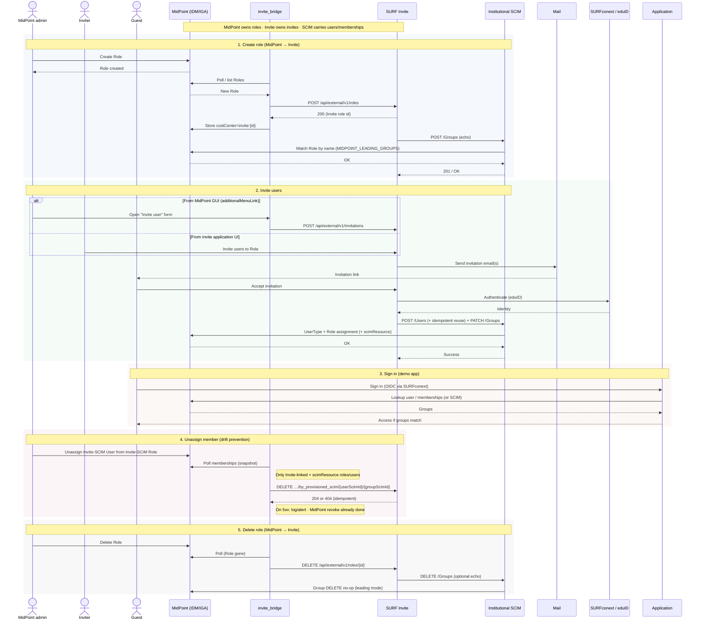

# MidPoint ↔ SURF Invite integration (reference)

Reference implementation of a **MidPoint-leading** integration with
[SURFconext Invite](https://openconext.github.io/OpenConext-Invite/): MidPoint is
the system of record for **roles/groups**; Invite owns the **invitation UX**;
users and memberships flow into MidPoint over **SCIM 2.0**.

Branch: `midpoint-leading`.

```text
MidPoint admin creates/deletes Role
        │
        ▼
invite_bridge  ──POST/DELETE──►  Invite /api/external/v1/roles
        │
        ▼
Invite may echo SCIM Group create/delete
        │
        ▼
SCIM (MIDPOINT_LEADING_GROUPS)  →  match Role by name / Group DELETE no-op

Invite invites guest → accept
        │
        ▼
SCIM User (+ idempotent reuse) + Group membership  →  MidPoint

MidPoint admin unassigns Invite-SCIM member
        │
        ▼
invite_bridge  ──DELETE──►  Invite …/user_roles/by_provisioned_scim/{user}/{group}
```

## What another MidPoint install needs (Invite only)

Custom code for this integration:

| Piece | Location | Purpose |
|-------|----------|---------|
| **`invite_bridge/`** | this repo | MidPoint Roles → Invite `POST/DELETE /roles`; membership revoke → `by_provisioned_scim`; Invite-user form; store `costCenter=invite:{id}` |
| **SCIM MidPoint plugin leading mode** | sibling [`../scim`](../scim) `code/data/plugins/midpoint.py` | `MIDPOINT_LEADING_GROUPS=true`: reuse Role by name on Group create; no-op Group DELETE; ignore empty `members:[]`; synthesize missing `meta` on read |
| **SCIM idempotent User create** | [`../scim`](../scim) `code/routers/users.py` | `SCIM_IDEMPOTENT_USER_CREATE`: re-POST same `userName`/`externalId` reuses existing User (avoids 409 on Invite re-provision) |
| **Manual helper (optional)** | `scripts/invite-create-role.sh` | One-shot Invite Role create with curl |
| **Live revoke smoke (optional)** | `scripts/integration_membership_revoke.py` | MidPoint unassign → Invite `by_provisioned_scim` against a running stack |

Plus configuration / platform (not MidPoint XML):

- SCIM service with MidPoint backend, exposed as Invite’s institutional SCIM URL
- Invite API token + org GUID + Manage application (`manageId` / `manageType`)
- OpenConext Manage: SCIM provisioner on that application; Invite must use **remote** Manage (`manage.enabled=true`), not static seed apps
- Env: see `.env.example` (`INVITE_*`, `MIDPOINT_LEADING_GROUPS`, MidPoint REST)

**Not required for Invite:** OneRoster, the OIDC demo app (demo only).

**Drift prevention:** MidPoint admin unassigns an Invite-SCIM user from an
Invite-SCIM role → bridge notifies Invite
(`DELETE …/user_roles/by_provisioned_scim/{userScimId}/{groupScimId}`).
Local MidPoint revoke always wins if Invite notify fails (logged/alert).

## Stack (full demo)

| Service | Role |
|---------|------|
| MidPoint + Postgres | IDM; Roles, Users, assignments |
| `scim` | Institutional SCIM → MidPoint REST (`../scim`) |
| `invite_bridge` | MidPoint Roles ↔ Invite API; membership drift prevention; Invite-user form |
| `application` | OIDC demo; membership pull (MidPoint / SCIM) |

**Not in compose / gitignored locally:** `ldap/`, `moodle/`, `moodle_bridge/` (and related Moodle DB init).

## Repository layout

```text
compose.yml / compose.traefik.yml / Makefile
invite_bridge/                 # MidPoint → Invite (core) + unit tests
scripts/invite-create-role.sh
scripts/integration_membership_revoke.py
application/                   # OIDC membership-pull demo
midpoint/post-initial-objects/ # scimResource schema (+ parked LDAP objects)
docs/scim-curl.md
docs/latex/                    # architecture PDF (make -C docs/latex pdf)
design.md                      # MidPoint-leading sequence (Mermaid)
TODO.md                        # remaining / parked notes
```

## Run

```bash
cp .env.example .env
cp .env.invite.example .env.invite   # current / shared Invite + OIDC
cp .test.env.example .test.env       # optional private Invite (safe retries)
# fill DOMAIN, MidPoint, INVITE_*, OIDC_* in the profile files

# without Traefik
docker compose -f compose.yml up --build

# with Traefik (hostnames *.${DOMAIN})
docker compose -f compose.yml -f compose.traefik.yml up --build
```

### Toggle Invite / SURFconext profile

`invite_bridge` and `application` load Invite + OIDC from compose `env_file`,
selected by `ENV_FILE` in `.env`:

| `ENV_FILE` | Use |
|------------|-----|
| `.env.invite` | Current SURF `invite.test` setup (default) |
| `.test.env` | Your private Invite / SURFconext (retries without touching the shared tenant) |

```bash
# Use private Invite
# in .env: ENV_FILE=.test.env
docker compose -f compose.yml -f compose.traefik.yml up -d --force-recreate --no-deps invite_bridge application

# Switch back
# in .env: ENV_FILE=.env.invite
docker compose -f compose.yml -f compose.traefik.yml up -d --force-recreate --no-deps invite_bridge application
```

Profiles use separate `INVITE_BRIDGE_STATE` paths so Invite role id links do not mix.

Rebuild after Python/SCIM changes:

```bash
docker compose -f compose.yml -f compose.traefik.yml up -d --build scim invite_bridge
```

## Configuration (Invite core)

### Invite external API (`invite_bridge`)

| Variable | Meaning |
|----------|---------|
| `INVITE_API_BASE_URL` | e.g. `https://invite.example.org/api/external/v1` |
| `INVITE_API_TOKEN` | Header `X-API-TOKEN` |
| `INVITE_ORGANIZATION_GUID` | Institution GUID (from Invite `GET …/users/me` or Manage) |
| `INVITE_APPLICATION_MANAGE_ID` | Manage entity id of the SP/RP that has the SCIM provisioner |
| `INVITE_APPLICATION_MANAGE_TYPE` | **Uppercase** enum: `SAML20_SP` \| `OIDC10_RP` \| … |
| `INVITE_APPLICATION_LANDING_PAGE` | Landing URL stored on the Invite Role |
| `INVITE_BRIDGE_SYNC_INTERVAL` | Poll interval seconds (default 30) |
| `INVITE_BRIDGE_SYNC_MEMBERSHIPS` | Notify Invite on MidPoint membership revoke (default `true`) |
| `INVITE_BRIDGE_MEMBERSHIPS_STATE` | Snapshot path (default: `*_memberships.json` beside `INVITE_BRIDGE_STATE`) |
| `INVITE_CREATE_FAIL_MAX_ATTEMPTS` | Max Invite role-create tries per MidPoint Role before giving up until bridge restart (default `1`) |
| `INVITE_CREATE_FAIL_BACKOFF_SECONDS` | Delay between those attempts when max &gt; 1 (default `0`) |
| `INVITE_BRIDGE_PUBLIC_URL` | Absolute URL of the invite form (default `https://invite-bridge.${DOMAIN}/invite`) |
| `INVITE_BRIDGE_REGISTER_MENU` | On start, add MidPoint `additionalMenuLink` “Invite user” (default `true`) |
| `INVITE_BRIDGE_UI_USER` / `INVITE_BRIDGE_UI_PASSWORD` | HTTP Basic for the form (password defaults to MidPoint admin password) |
| `INVITE_INVITATION_EXPIRY_DAYS` | Default invitation validity on the form (default 14) |

Discover org/app after the token works:

```bash
curl -sS -H "X-API-TOKEN: $INVITE_API_TOKEN" \
  "$INVITE_API_BASE_URL/users/me" | jq '{organizationGUID, applications}'

curl -sS -H "X-API-TOKEN: $INVITE_API_TOKEN" \
  "$INVITE_API_BASE_URL/manage/providers" | jq
```

If `/manage/providers` only lists seed apps (wiki, calendar, …), Invite is on
**LocalManage** (`manage.enabled=false`). Point Invite at your real Manage and
restart Invite before expecting real SPs or SCIM echoes.

Swagger (typical): `https://<invite-host>/ui/swagger-ui/index.html`

### SCIM

| Variable | Meaning |
|----------|---------|
| `SCIM_API_KEY` | Bearer token; must match Manage SCIM provisioner |
| `SCIM_BASE_PATH` | Default `/api/v2` |
| `MIDPOINT_URL` / `MIDPOINT_USERNAME` / `MIDPOINT_PASSWORD` | MidPoint REST for the plugin |
| `MIDPOINT_LEADING_GROUPS` | `true` (default in compose) for MidPoint-leading Group behaviour |
| `SCIM_IDEMPOTENT_USER_CREATE` | `true` (default): re-POST User with same `userName`/`externalId` reuses instead of 409 |

Invite’s Manage SCIM provisioner should target `https://scim.${DOMAIN}/api/v2`
(or your public SCIM URL).

### MidPoint

- `MIDPOINT_ADMIN_INITIAL_PASSWORD` — initial admin password (also default REST password)
- Application Roles created in MidPoint GUI are picked up by `invite_bridge` (system roles / `metarole-*` skipped)

Link to Invite is stored on the Role as `costCenter = invite:{numericId}` (demo convenience; a proper extension attribute is preferable for production).

## Behaviour

### 1. Create Role (MidPoint → Invite)

1. Administrator creates an application Role in MidPoint.
2. Within ~`INVITE_BRIDGE_SYNC_INTERVAL` seconds, `invite_bridge` calls
   `POST /api/external/v1/roles` with the same name and configured Manage application.
3. Invite may `POST /Groups` to SCIM; with `MIDPOINT_LEADING_GROUPS` the plugin
   binds to the existing MidPoint Role by `displayName` (no second Role).
4. Bridge writes `costCenter=invite:{id}` on the MidPoint Role.

### 2. Invite users / accept (Invite → SCIM → MidPoint)

Two equivalent ways to start an invitation (both call Invite
`POST /api/external/v1/invitations`; neither creates a MidPoint User yet):

1. **MidPoint GUI** — menu item **Invite user** (registered by `invite_bridge`
   as `adminGuiConfiguration/additionalMenuLink`) opens
   `https://invite-bridge.${DOMAIN}/invite`. Only MidPoint Roles that Invite
   has already SCIM-provisioned (`extension/scimResource`) are listed; enter
   email and submit (HTTP Basic).
2. **Invite application UI** — unchanged.

Guest accepts (eduID); Invite then provisions **User** and **Group membership**
over SCIM into MidPoint. With `SCIM_IDEMPOTENT_USER_CREATE`, a re-POST for an
existing `userName`/`externalId` reuses the MidPoint User (no 409).

### 3. Delete Role (MidPoint → Invite)

When the MidPoint Role disappears, the bridge `DELETE`s the linked Invite Role
(by stored id). Invite may SCIM-delete the Group; leading mode **does not**
delete the MidPoint Role on that echo (Role is already gone).

### 4. Unassign member (MidPoint → Invite)

Invite remains source of truth for guest memberships it provisioned. If a
MidPoint admin removes such a membership locally without telling Invite, VOOT/AA
and app access diverge. On each poll the bridge:

1. Watches MidPoint Roles that are **Invite-linked** (`costCenter=invite:…`)
   **and** SCIM-provisioned (`extension/scimResource`).
2. Tracks only **Invite-SCIM Users** on those roles (users with `scimResource`).
   Purely local MidPoint users/roles never trigger Invite calls.
3. When a previously seen Invite-SCIM member disappears from such a role, calls

   `DELETE /api/external/v1/user_roles/by_provisioned_scim/{userScimId}/{groupScimId}`

   using **our** SCIM User/Group `id`s (the values Invite stored after SCIM create).
4. Treats Invite `404` as success; on other Invite errors **keeps** the MidPoint
   revoke and logs clearly (app security is not blocked on Invite notify).

Membership revoke is preferred over Invite `DELETE /deprovision/{userId}`
(`LIFECYCLE` auth). Do not delete Invite-provisioned Groups as a normal MidPoint
admin action beyond Role delete (already synced); there is no separate Invite
Group-delete API for SP-side cleanup.

Cold start with an empty membership snapshot only baselines; it does not mass-revoke.

Unit tests: `python -m unittest invite_bridge/test_membership_sync.py` (from a
venv with `invite_bridge/requirements.txt`).

### 5. Demo app

- Demo app at `app.${DOMAIN}` can pull memberships from MidPoint or SCIM.

## Operator checks

```bash
# Makefile defaults to Traefik overlay (STACK=local for compose.yml only)
make build          # up -d --build
make logs SERVICE=invite_bridge

# Manual Invite role create (same env as bridge)
./scripts/invite-create-role.sh "my-role-name"

# Unit tests (venv with invite_bridge/requirements.txt)
cd invite_bridge && python -m unittest test_membership_sync.py -v

# Live membership-revoke smoke (inside invite_bridge; needs an Invite-SCIM member)
docker compose -f compose.yml -f compose.traefik.yml cp \
  scripts/integration_membership_revoke.py invite_bridge:/tmp/itest.py
docker compose -f compose.yml -f compose.traefik.yml exec -T invite_bridge \
  python /tmp/itest.py

# Recreate bridge after ENV_FILE / INVITE_* changes
docker compose -f compose.yml -f compose.traefik.yml up -d --force-recreate --no-deps invite_bridge
```

## Design diagram

Full sequence (rendered by GitHub): see **[design.md](design.md)**.



LaTeX PDF still embeds a static PNG (`docs/latex/figures/invite-sequence.png`).
Update that figure when the Mermaid flow changes (screenshot or Mermaid CLI export).

LaTeX write-up: `docs/latex/` (`make -C docs/latex pdf`).

## Related

- OpenConext Invite: <https://openconext.github.io/OpenConext-Invite/>
- Invite SCIM client behaviour: <https://openconext.github.io/OpenConext-Invite/SCIM/>
- Remaining / parked work: `TODO.md`
