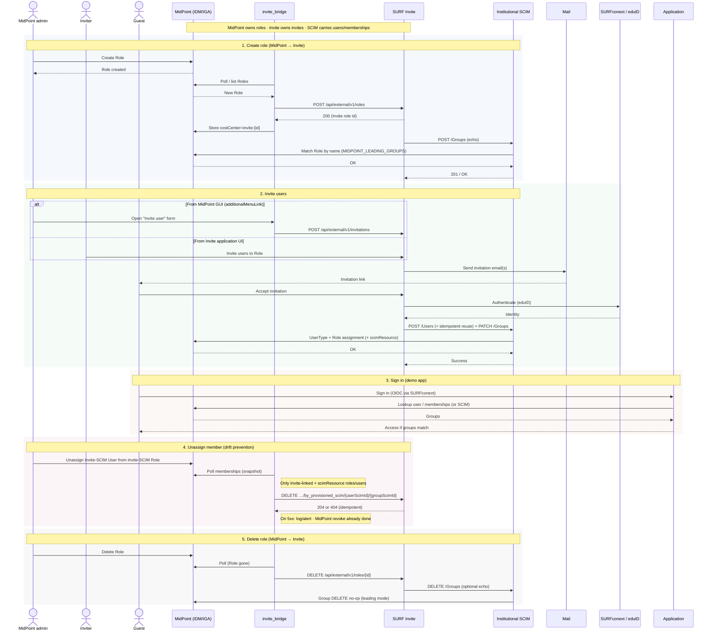

# MidPoint ↔ SURF Invite — sequence

MidPoint-leading: MidPoint owns Role create/delete; Invite owns invitation UX;
users and memberships enter MidPoint via SCIM. MidPoint unassign of Invite-SCIM
members notifies Invite (drift prevention).

